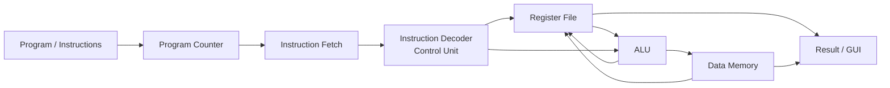
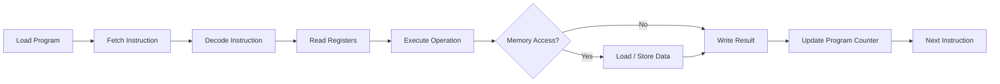

# Mini RISC-V Instruction Emulator

> **Computer Architecture Project Proposal**  
> Architecture: **RISC-V (RV32I Subset)**

---

## Project Overview

The **Mini RISC-V Instruction Emulator** is a Computer Architecture project that simulates how a simple RISC-V processor executes instructions.

The project will demonstrate the main CPU stages including instruction fetch, instruction decoding, register access, ALU execution, and memory operations.

The emulator will use a small RV32I instruction subset so the project remains simple to implement, test, demonstrate, and explain.

---

## Proposed 5 Modules

### 1. Program Counter & Instruction Fetch
Keeps track of the current instruction address and fetches the next instruction from the program.

### 2. Instruction Decoder & Control Unit
Decodes the instruction and identifies the operation, source registers, destination register, immediate value, and required control signals.

### 3. Register File
Simulates the RISC-V register set and stores values used by instructions during execution.

### 4. Arithmetic Logic Unit (ALU)
Performs arithmetic and logical operations such as `ADD`, `SUB`, `AND`, `OR`, and `XOR`.

### 5. Memory & Load/Store Unit
Simulates simple data memory and handles load/store instructions such as `LW` and `SW`.

---

## System Architecture



---

## Instruction Execution Flow



---

## Supported Instructions

The first version will support a small RISC-V instruction set:

```text
ADD
SUB
ADDI
AND
OR
XOR
LW
SW
BEQ
BNE
```

More instructions can be added later if required.

---

## Planned Interface

The simulator will display:

- Current Program Counter
- Current Instruction
- Register Values
- ALU Operation
- Memory Values
- Execution Log

Controls:

```text
Load Program
Step
Run
Reset
```

---

## Main Technologies

- **Python** — simulator logic
- **Tkinter** — graphical user interface
- **RISC-V RV32I** — instruction architecture
- **Git & GitHub** — version control and documentation
- **VS Code** — development environment

---

## Final Goal

```text
RISC-V Program
      +
5 Architecture Modules
      =
Mini RISC-V Instruction Emulator
```

The final project will demonstrate how a basic RISC-V processor fetches, decodes, and executes instructions step by step.

---

## Current Status

**Status:** Project Selection / Planning Stage  
**Implementation:** Not started yet  
**Next Step:** Implement the five modules one by one and connect them through a simple GUI.
